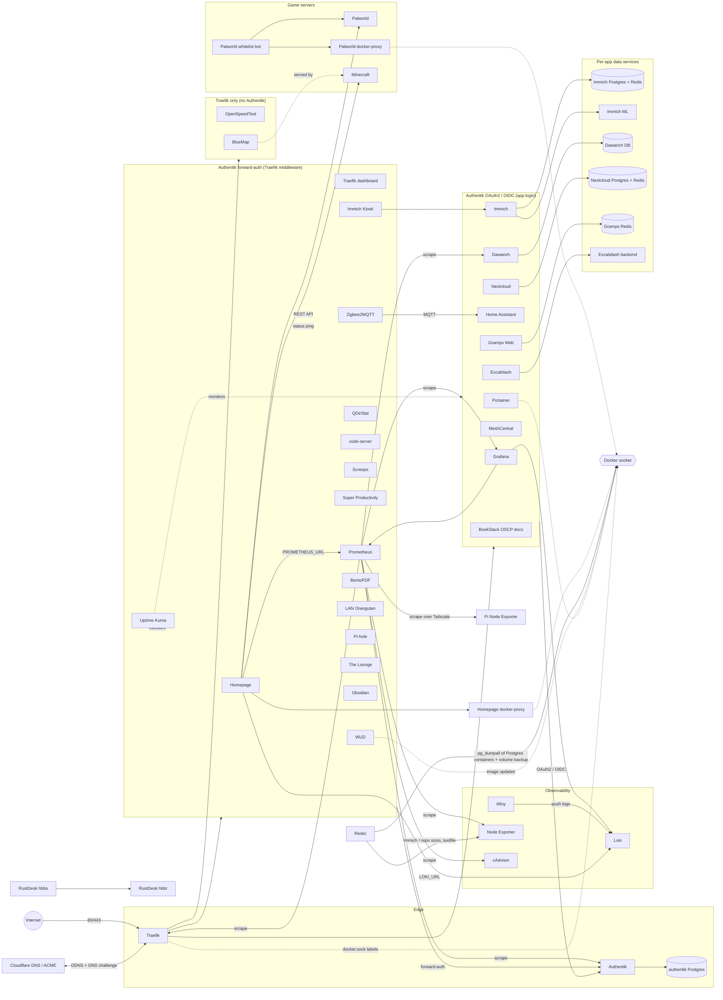

# homelab-compose

Simple Docker Compose files for my homelab services.

## Services

- `authentik/`: Identity provider and forward-auth middleware for Traefik
- `bentopdf/`: BentoPDF client-side PDF toolbox behind Traefik + Authentik
- `dawarich/`: Dawarich location history (Postgres/PostGIS, Redis) with Authentik OIDC login
- `excalidash/`: Excalidash Excalidraw dashboard (frontend + backend) with Authentik OIDC login
- `genealogy/`: Gramps Web (multi-tree) with Authentik OIDC login
- `grafana/`: Observability stack (Grafana, Prometheus, Loki, Alloy, Node Exporter)
- `homeassistant/`: Home Assistant, Mosquitto and Zigbee2MQTT
- `homepage/`: Custom homepage on `thomega.fr` (service status, server/NAS/Pi storage with Immich & backup share, Minecraft & Palworld overview) behind Authentik
- `immich-app/`: Immich stack (server, ML, Redis, Postgres) and Immich Kiosk
- `lan-orangutan/`: LAN Orangutan network device scanner (host network)
- `meshcentral/`: MeshCentral remote device management
- `minecraft/`: Minecraft server with the BlueMap web map
- `book-stack/`: BookStack OSCP documentation with native Authentik OIDC and MariaDB
- `nextcloud/`: Nextcloud with Postgres and Redis, data on the NAS
- `obsidian/`: Obsidian desktop app in the browser (Selkies), vaults in `/data/obsidian/config`, behind Traefik + Authentik
- `openspeedtest/`: OpenSpeedTest self-hosted speed test server
- `palworld/`: Palworld dedicated server with a Discord whitelist bot
- `pihole/`: Pi-hole DNS (macvlan), not the LAN default: the ISP box does DHCP and DNS, currently under maintenance
- `portainer/`: Portainer CE container management UI
- `qdirstat/`: QDirStat disk usage analyzer (host `/` mounted read-only) behind Traefik + Authentik
- `restic/`: Backups to the NAS every 2 h (Postgres dumps, `/data`, NAS shares) and copy to the Pi's WD My Cloud twice a week
- `rpi/`: Raspberry Pi stacks (see [rpi/README.md](rpi/README.md))
- `rustdesk/`: RustDesk self-hosted server (hbbs + hbbr)
- `screeps/`: Screeps relay UI behind Traefik + Authentik
- `super-productivity/`: Super Productivity + WebDAV sync behind Traefik
- `thelounge/`: The Lounge web IRC client behind Traefik + Authentik (private mode: own account, persistent connection)
- `traefik/`: Reverse proxy + TLS (Let's Encrypt DNS challenge with Cloudflare) + Cloudflare DDNS
- `uptime-kuma/`: Uptime Kuma monitoring dashboard
- `vscode/`: code-server exposed behind Traefik + Authentik
- `wud/`: What's Up Docker image update checks behind Traefik + Authentik

## Dependency graph



## Authentication

Every web app goes through Traefik. Authentik (`auth.thomega.fr`) protects them in one of two ways:

| Mode | Apps |
| --- | --- |
| **Forward-auth** (Traefik `authentik-auth@docker` middleware + Authentik proxy provider, login before the app loads) | Homepage, Traefik dashboard, Prometheus, Immich Kiosk, Zigbee2MQTT, BentoPDF, Screeps, Super Productivity, Uptime Kuma, What's Up Docker, Pi-hole (`/admin/img` + `/api` bypass), LAN Orangutan, QDirStat, VS Code, The Lounge, Obsidian |
| **OAuth2 / OIDC** (Authentik OAuth2 provider, "Login with Authentik" in the app) | Grafana, Immich, Nextcloud, Home Assistant, Portainer, Dawarich, Excalidash, MeshCentral, Gramps Web, BookStack |
| **None** (public) | OpenSpeedTest, BlueMap (Minecraft map) |

Not web apps: RustDesk, Minecraft, Palworld, Restic. The Pi services (`rpi/`) are LAN-only.

Most OIDC clients are configured in each app's UI (Immich, Nextcloud, Home Assistant, Portainer). The `.env`-based clients are Grafana, Dawarich, Excalidash, BookStack, and Gramps Web; MeshCentral uses `config.json`.


## Requirements

- Docker + Docker Compose v2
- Valid `.env` values for each stack that needs secrets/tokens

## Quick start

1. Go to a stack folder (`authentik`, `grafana`, `homeassistant`...).
2. Create required `.env` if the stack provides a template.
3. Start the stack.
4. Open its URL.

Commands:

```bash
cd <stack-folder>
[ -f .env.dist ] && cp .env.dist .env
docker compose up -d
docker compose ps
docker compose logs -f
```

## URLs

- Homepage: `https://thomega.fr`
- BentoPDF: `https://pdf.thomega.fr`
- BlueMap (Minecraft map): `https://minecraft.thomega.fr`
- Dawarich: `https://dawa.thomega.fr`
- Excalidash: `https://excalidash.thomega.fr`
- Gramps Web: `https://gen.thomega.fr`
- Grafana: `https://grafana.thomega.fr`
- Prometheus: `https://prometheus.thomega.fr`
- Home Assistant: `https://home.thomega.fr`
- Immich: `https://photo.thomega.fr`
- Immich Kiosk: `https://kiosk.thomega.fr`
- LAN Orangutan: `https://lano.thomega.fr`
- Nextcloud: `https://nextcloud.thomega.fr`
- Obsidian: `https://obsidian.thomega.fr`
- OpenSpeedTest: `https://speed.thomega.fr`
- Portainer: `https://portainer.thomega.fr`
- QDirStat: `https://qdirstat.thomega.fr`
- RustDesk server: `https://rust.thomega.fr`
- Screeps: `https://screeps.thomega.fr`
- Super Productivity: `https://sp.thomega.fr`
- The Lounge (IRC): `https://irc.thomega.fr`
- Traefik dashboard: `https://traefik.thomega.fr`
- Authentik: `https://auth.thomega.fr`
- MeshCentral: `https://mesh.thomega.fr`
- BookStack (OSCP): `https://oscp.thomega.fr`
- Pi-hole: `https://hole.thomega.fr`
- Uptime Kuma: `https://upk.thomega.fr`
- VS Code: `https://vscode.thomega.fr`
- What's Up Docker: `https://wud.thomega.fr`
- Zigbee2MQTT: `https://zigbee2mqtt.thomega.fr`

## Notes

- `traefik/` creates the shared Docker network `traefik-net`; start this stack before other services that attach to it.
- `homepage/` also joins `grafana_monitoring` (Loki) and `palworld_default` (Palworld REST API): start `grafana/` and `palworld/` first. Services and game settings are in `homepage/config.yml`.
- `pihole/` uses macvlan with a static IP (`PIHOLE_IP`) and wildcard DNS for `*.thomega.fr` routed to the server (`SERVER_IP`); set them in `pihole/.env`. It is not the LAN DNS/DHCP server anymore (repeated outages, probably from the macvlan network): the ISP box handles both.

## Host: NAS mounts before Docker

The NAS shares `/mnt/nas` (restic repository, Nextcloud data) and `/mnt/nas-images` (Immich uploads) are CIFS mounts in the host `/etc/fstab` (`_netdev`). NetworkManager can report the network online at boot before the LAN interface has an address. The mounts then fail with `cifs_mount failed w/return code = -101` (network unreachable) and Docker starts with empty mountpoints:

- `restic` exits with code 127: `open /mnt/nas/backups: no such file or directory`.
- `immich_server` restarts in a loop: `Failed to read ... encoded-video/.immich`.

A `docker.service` drop-in retries the mounts for up to 60 s before Docker starts. If the NAS is still unreachable, Docker starts anyway so the other apps keep working.

`/etc/systemd/system/docker.service.d/wait-nas.conf`:

```ini
# NetworkManager reports online before the LAN has an address, so the boot CIFS mounts can fail.
[Service]
ExecStartPre=-/usr/local/sbin/wait-nas-mounts.sh
```

`/usr/local/sbin/wait-nas-mounts.sh` (mode `0755`):

```sh
#!/bin/sh
# Retry the NAS CIFS mounts before Docker starts, so containers don't bind-mount empty mountpoints.
for i in $(seq 1 12); do
    ok=1
    for m in /mnt/nas /mnt/nas-images; do
        mountpoint -q "$m" || mount "$m" 2>/dev/null || ok=0
    done
    [ "$ok" = 1 ] && exit 0
    sleep 5
done
echo "NAS mounts still missing, starting Docker anyway" >&2
exit 0
```

Apply with `sudo systemctl daemon-reload`; check with `systemctl cat docker.service`. The script's output is in `journalctl -b -u docker`.

If the shares are still missing after boot (NAS down at the time), mount them and restart the containers that use them:

```bash
sudo systemctl start mnt-nas.mount 'mnt-nas\x2dimages.mount'
docker restart restic immich_server
cd nextcloud && docker compose restart
```
