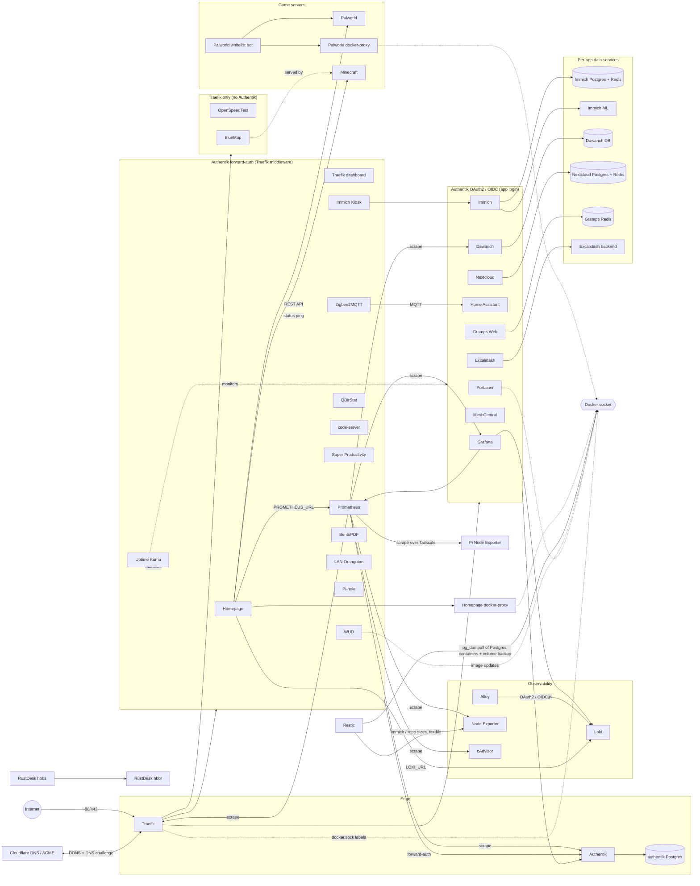

# homelab-compose

Simple Docker Compose files for my homelab services.

## Services

- `authentik/`: Identity provider and forward-auth middleware for Traefik
- `genealogy/`: Gramps Web (multi-tree) with Authentik OIDC login
- `grafana/`: Observability stack (Grafana, Prometheus, Loki, Alloy, Node Exporter)
- `homeassistant/`: Home Assistant
- `homepage/`: Custom homepage on `thomega.fr` (service status, server/NAS/Pi storage with Immich & backup share, Minecraft & Palworld overview) behind Authentik
- `immich-app/`: Immich stack (server, ML, Redis, Postgres)
- `lan-orangutan/`: LAN Orangutan network device scanner (host network)
- `meshcentral/`: MeshCentral remote device management
- `nextcloud/`: Nextcloud AIO master container
- `openspeedtest/`: OpenSpeedTest self-hosted speed test server
- `pihole/`: Pi-hole DNS + DHCP (macvlan)
- `portainer/`: Portainer CE container management UI
- `qdirstat/`: QDirStat disk usage analyzer (host `/` mounted read-only) behind Traefik + Authentik
- `rustdesk/`: RustDesk self-hosted server (hbbs + hbbr)
- `super-productivity/`: Super Productivity + WebDAV sync behind Traefik
- `traefik/`: Reverse proxy + TLS (Let's Encrypt DNS challenge with Cloudflare) + Cloudflare DDNS
- `uptime-kuma/`: Uptime Kuma monitoring dashboard
- `vscode/`: code-server exposed behind Traefik + Authentik

## Dependency graph



## Authentication

Every web app goes through Traefik. Authentik (`auth.thomega.fr`) protects them in one of two ways:

| Mode | Apps |
| --- | --- |
| **Forward-auth** (Traefik `authentik-auth@docker` middleware + Authentik proxy provider, login before the app loads) | Homepage, Traefik dashboard, Prometheus, Immich Kiosk, Zigbee2MQTT, BentoPDF, Super Productivity, Uptime Kuma, What's Up Docker, Pi-hole (`/admin/img` + `/api` bypass), LAN Orangutan, QDirStat, VS Code |
| **OAuth2 / OIDC** (Authentik OAuth2 provider, "Login with Authentik" in the app) | Grafana, Immich, Nextcloud, Home Assistant, Portainer, Dawarich, Excalidash, MeshCentral, Gramps Web |
| **None** (public) | OpenSpeedTest, BlueMap (Minecraft map) |

Not web apps: RustDesk, Minecraft, Palworld, Restic. The Pi services (`rpi/`) are LAN-only.

Most OIDC clients are configured in each app's UI (Immich, Nextcloud, Home Assistant, Portainer). Grafana, Dawarich, Excalidash, Gramps Web (`.env`) and MeshCentral (`config.json`) are configured here.

### Gramps Web trees

Gramps Web runs multi-tree (`GRAMPSWEB_TREE: "*"`). An OIDC account belongs to one tree, and the tree must be chosen *before* the redirect to Authentik, which the Gramps frontend never does. Traefik handles that:

- Authentik app **Gramps Web** has the launch URL `https://gen.thomega.fr/sso/%(username)s`. Traefik redirects `fgdou` to *Arbre Fabien Dufour* and everyone else to *Arbre Thomas Delapart*.
- The "Authentik" button on the Gramps login page (no tree) defaults to *Arbre Thomas Delapart*. Fabien has to use the Authentik tile or `https://gen.thomega.fr/sso/fgdou`.
- Roles come from the Authentik scope mapping **Gramps Web role** (`gramps` scope, `gramps_role` claim): `thomega`/`fgdou` get `admin`, everyone else `member`. Gramps re-applies the role at every login.
- The existing local accounts `Thomega` and `Fgdou` are linked to their Authentik identities in the `oidc_accounts` table of `/data/genealogy/users/users.sqlite` (provider `custom`, `subject_id` = Authentik hashed user ID). Local password login still works as a fallback.

## Requirements

- Docker + Docker Compose v2
- Valid `.env` values for each stack that needs secrets/tokens

## Quick start

1. Go to a stack folder (`authentik`, `grafana`, `homeassistant`...).
2. Create required `.env` if the stack provides a template.
3. Start the stack.
4. Open its URL.

Commands:

```bash
cd <stack-folder>
[ -f .env.dist ] && cp .env.dist .env
docker compose up -d
docker compose ps
docker compose logs -f
```

## URLs

- Homepage: `https://thomega.fr`
- Gramps Web: `https://gen.thomega.fr`
- Grafana: `https://grafana.thomega.fr`
- Prometheus: `https://prometheus.thomega.fr`
- Home Assistant: `https://home.thomega.fr`
- Immich: `https://photo.thomega.fr`
- LAN Orangutan: `https://lano.thomega.fr`
- Nextcloud AIO: `https://nextcloud.thomega.fr`
- OpenSpeedTest: `https://speed.thomega.fr`
- Portainer: `https://portainer.thomega.fr`
- QDirStat: `https://qdirstat.thomega.fr`
- RustDesk server: `https://rust.thomega.fr`
- Super Productivity: `https://sp.thomega.fr`
- Traefik dashboard: `https://traefik.thomega.fr`
- Authentik: `https://auth.thomega.fr`
- MeshCentral: `https://mesh.thomega.fr`
- Pi-hole: `https://hole.thomega.fr`
- Uptime Kuma: `https://upk.thomega.fr`
- VS Code: `https://vscode.thomega.fr`

## Notes

- `traefik/` creates the shared Docker network `traefik-net`; start this stack before other services that attach to it.
- `homepage/` also joins `grafana_monitoring` (Loki) and `palworld_default` (Palworld REST API): start `grafana/` and `palworld/` first. Services and game settings are in `homepage/config.yml`.
- `pihole/` uses macvlan with a static IP (`PIHOLE_IP`) and wildcard DNS for `*.thomega.fr` routed to the server (`SERVER_IP`); set them in `pihole/.env`.
